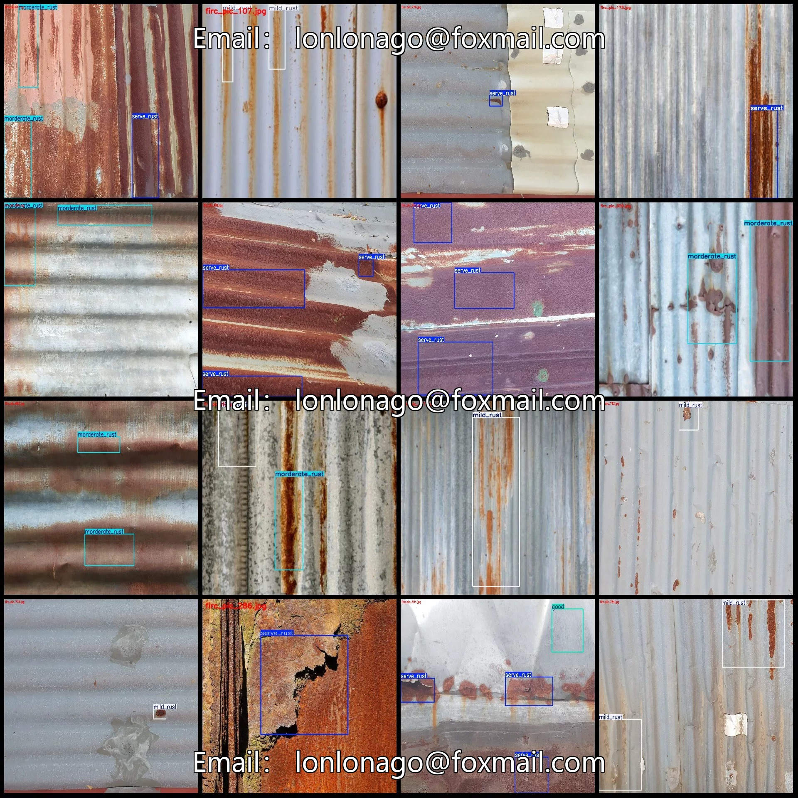
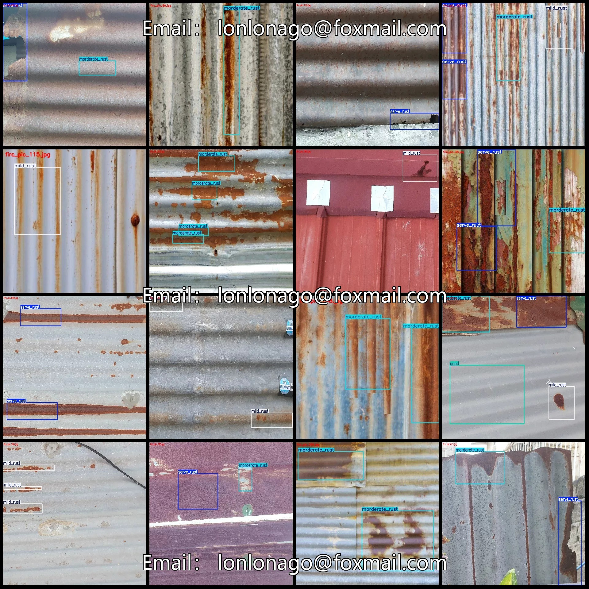
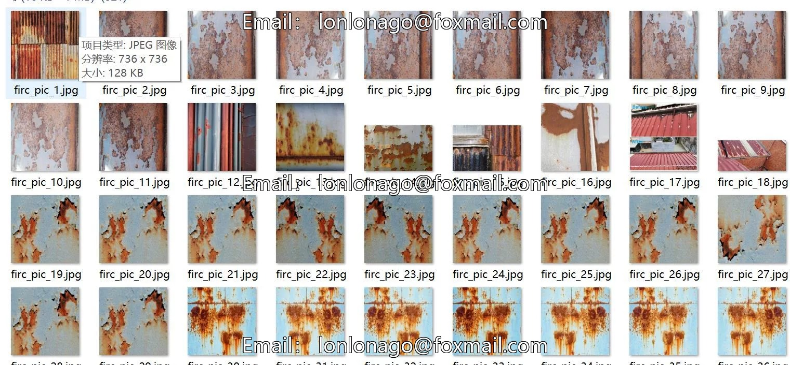
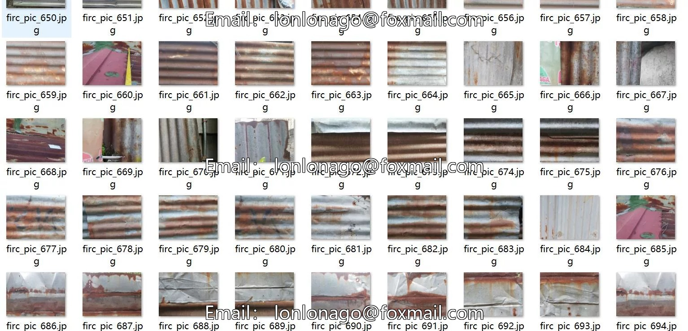
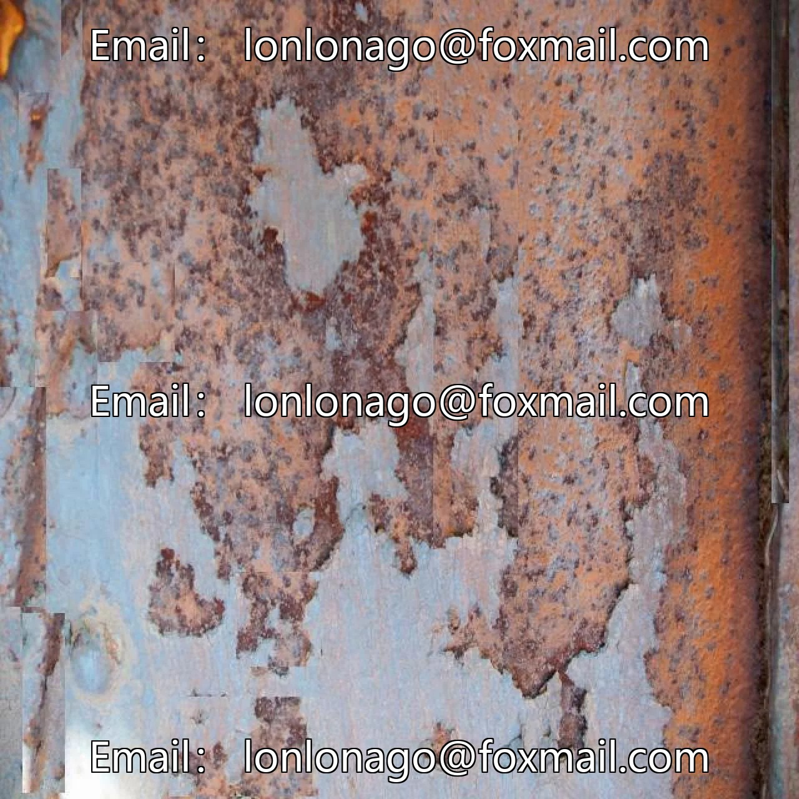
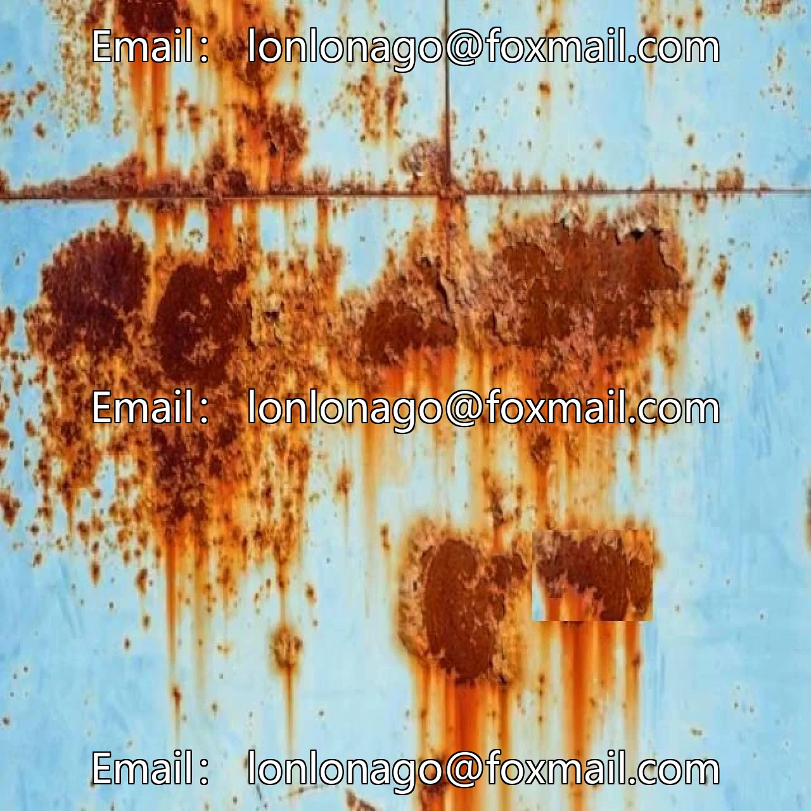

# Pitched-roof house corrosion detection dataset in VOC+YOLO format, 822

## Body

Plate steel house rust detection dataset - VOC+YOLO format with 822 images in 5 categories enhanced
Please note: Due to the dataset's replicability, please confirm compliance before purchasing.
The dataset contains many enhanced images, which can be seen in detail.
Dataset format: Pascal VOC format + YOLO format (txt file without segmentation paths, only containing jpg images and corresponding VOC format xml files and yolo format txt files)
Number of images (number of jpg files): 822
Number of annotations (number of xml files): 822
Number of annotations (number of txt files): 822
Number of annotation categories: 5

Annotation categories (Note that the order of YOLO format categories does not correspond to this, but is based on the labels folder's classes.txt): ["good", "mild_rust", "morderate_rust", "serve_rust", "tin_sheet_house"]
Number of bounding boxes per category:
- good (Good condition) = 54
- mild_rust (Mild rust) = 437
- moderate_rust (Morderate rust) = 566
- severe_rust (Serve rust) = 763

Tin Sheets House (i.e., Tin Sheets) Frame Count = 18
Total Frame Count: 1838
Number of Images per Category
Good (Good condition) Number of Images = 53
Mild Rust (Light rust) Number of Images = 283
Moderate Rust (Medium rust) Number of Images = 350
Severe Rust (Severe rust) Number of Images = 386
Tin Sheets House (i.e., Tin Sheets) Number of Images = 18
Image Resolution: 2016x1512
Labeling Tool: labelImg
Labeling Rules: Draw a rectangle around the category.

Important Notice: The dataset does not have separate training, validation, and test sets; you need to partition them yourself.
Special : This dataset does not guarantee the accuracy of the trained models or weight files.

## Images

## Payment

Here is a pay link on Stripe ( https://buy.stripe.com/3cs8yP7sY87d0vu9AB ). Please contact me lonlonago@foxmail.com after funding $89, and I will send you a complete data files , thank you!

